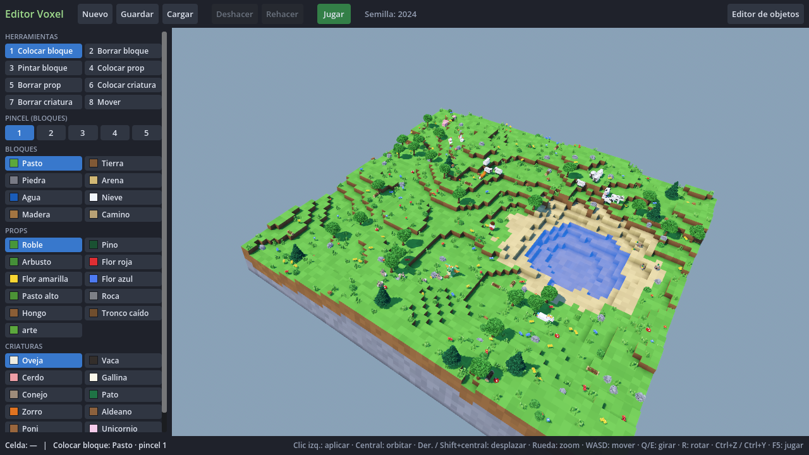
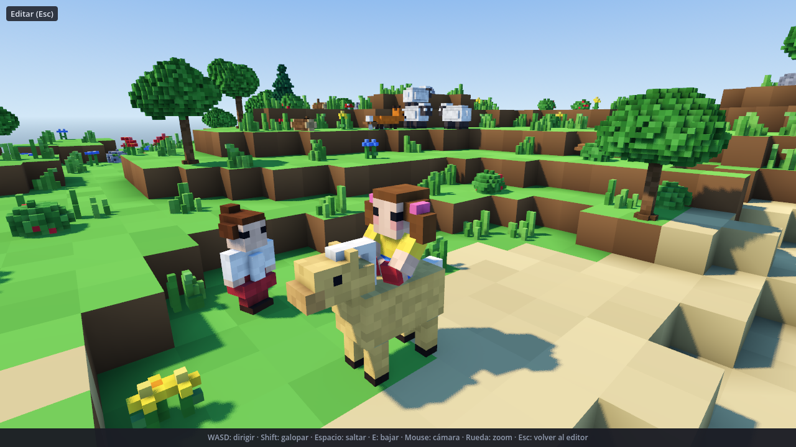
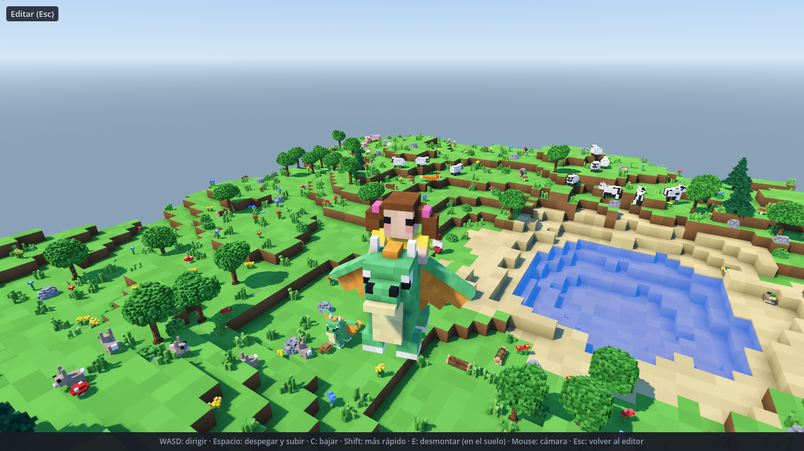
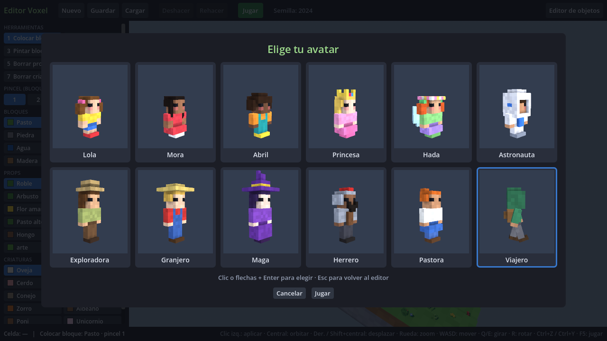
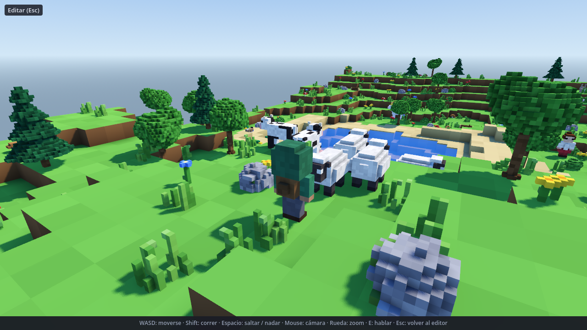
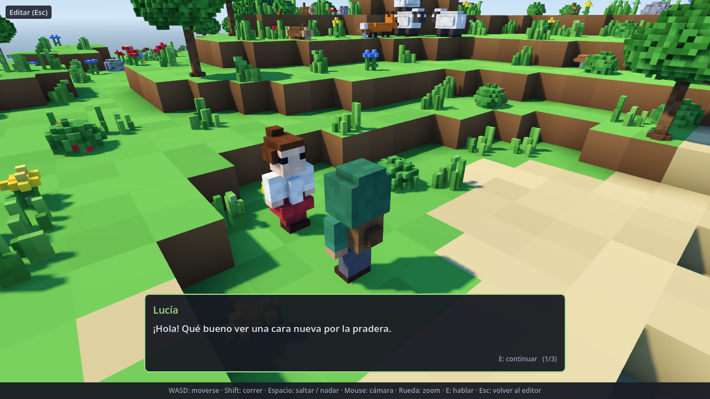
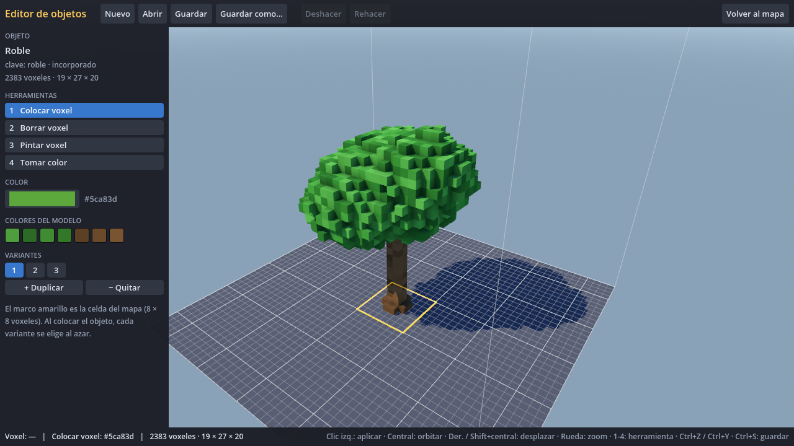
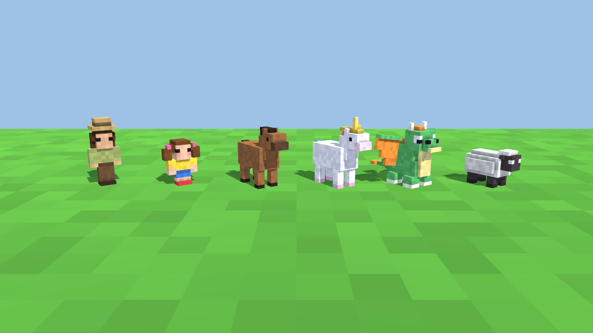
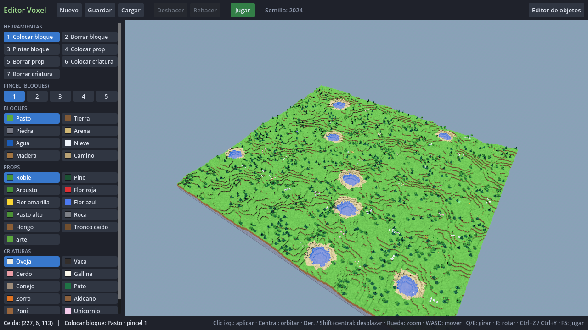

# Editor Voxel

Editor de mapas estilo voxel hecho en Godot 4.8 (GDScript, renderer Forward+). Genera una
pradera de 64×64 con lomas, un estanque y vegetación, y permite editar bloques y props,
deshacer/rehacer y guardar/cargar el mapa en JSON.

No usa assets externos ni addons: todas las mallas, materiales y la interfaz se construyen
por código. Las decisiones de diseño están en [docs/ALTERNATIVAS.md](docs/ALTERNATIVAS.md).



## Cómo abrirlo

- **Desde el editor:** abrir Godot 4.8, *Importar* y elegir `project.godot`. Ejecutar con F5.
  Godot muestra el juego incrustado en su pestaña *Game* y, por defecto, a **tamaño fijo**:
  aunque se maximice esa ventana, el contenido queda de 1280 × 720. Para que ocupe toda la
  ventana, en la barra de la pestaña *Game* elegir **Stretch to Fit** en el menú de tamaño
  (o desactivar *Embed Game on Next Play* para que el juego abra en su propia ventana).
- **Desde la consola** (PowerShell):

  ```powershell
  $godot = "B:\Users\Terraplanista\Godot\Godot_v4.8_dev4\Godot_v4.8-beta2_win64_console.exe"
  & $godot --headless --path B:\pkm\revNegro2\voxel_editor --import   # solo la primera vez
  & $godot --path B:\pkm\revNegro2\voxel_editor
  ```

Argumentos opcionales (después de `--`):

| Argumento | Efecto |
| --- | --- |
| `--seed=<entero>` | Semilla de la pradera inicial. |
| `--size=<S\|M\|L>` | Tamaño del mapa inicial: S 64 × 64 (por defecto), M 128 × 128, L 256 × 256. |
| `--ui-scale=<número>` | Fuerza la escala de la interfaz (por defecto se calcula según el alto de la ventana). |
| `--shot=<ruta png absoluta>` | Guarda una captura a los ~30 frames y cierra. |
| `--shot-mode=<modo>` | Qué capturar con `--shot`: `editor` (por defecto), `selector`, `play`, `dialogo`, `montando` o `volando`. |
| `--shot-size=<ancho>x<alto>` | Tamaño de la ventana para la captura, por ejemplo `--shot-size=1920x1080`. |
| `--objects` | Arranca en el editor de objetos (se puede combinar con `--shot`). |
| `--object=<clave>` | Arranca en el editor de objetos con ese objeto abierto, por ejemplo `--object=roble`. |

## Controles

| Acción | Control |
| --- | --- |
| Aplicar la herramienta | Clic izquierdo (mantener y arrastrar para seguir aplicando) |
| Orbitar la cámara | Arrastrar con el botón central |
| Desplazar la cámara | Arrastrar con el botón derecho, o Shift + botón central |
| Zoom | Rueda del mouse |
| Mover el foco de la cámara | W A S D o flechas |
| Girar la cámara | Q / E |
| Elegir herramienta | 1 colocar bloque · 2 borrar bloque · 3 pintar bloque · 4 colocar prop · 5 borrar prop · 6 colocar criatura · 7 borrar criatura · 8 mover |
| Rotar el prop o la criatura a colocar o a mover (90°) | R |
| Mover un prop, animal o aldeano | Herramienta **Mover** (8): arrastrarlo, o clic para levantarlo y otro clic para soltarlo |
| Editar el nombre y el diálogo de un aldeano | Con "colocar criatura", clic sobre un aldeano ya colocado |
| Entrar al modo juego | Botón **Jugar** o F5 |
| Deshacer | Ctrl+Z |
| Rehacer | Ctrl+Y o Ctrl+Shift+Z |

Notas de uso:

- El **pincel** (1 a 5) es una huella cuadrada sobre el plano de la cara apuntada y solo
  afecta a las herramientas de bloques. El cursor muestra exactamente las celdas afectadas.
- Al **colocar** o **borrar** bloques arrastrando, el trazo queda fijado a la capa del primer
  clic: no apila torres hacia la cámara ni cava pozos.
- Un trazo completo (presionar, arrastrar, soltar) es **un solo paso** de deshacer, incluidos
  los props que se quitan solos al perder su bloque de apoyo o al quedar tapados.
- Los props van en la celda de aire sobre un bloque sólido, uno por celda. Cada colocación
  usa una variante al azar; la vista previa muestra la que se va a colocar.
- **Guardar** y **Cargar** usan la carpeta `user://maps/`
  (`%APPDATA%\Godot\app_userdata\Editor Voxel\maps` en Windows).
- **Nuevo** abre un diálogo para elegir el tamaño del mapa y la semilla (ver *Tamaños de
  mapa*). El mapa actual se reemplaza y el historial de deshacer se vacía.
- **F11** alterna entre pantalla completa y ventana, tanto en el editor como jugando.

## Herramientas

Al pasar el mouse por un botón de herramienta aparece una ayuda con un ejemplo, y al elegirla
la misma explicación se muestra unos segundos en la línea de estado.

| Herramienta | Para qué sirve |
| --- | --- |
| Colocar bloque | Agrega bloques del tipo elegido sobre la cara apuntada (levantar una loma o un muro). |
| Borrar bloque | Quita bloques (cavar un pozo, abrir un túnel). |
| Pintar bloque | Cambia el tipo de un bloque que ya existe, sin agregar ni quitar (convertir pasto en camino). |
| Colocar prop | Pone el prop elegido sobre un bloque. |
| Borrar prop | Quita un prop con un clic sobre él. |
| Colocar criatura | Pone el animal o aldeano elegido; un clic sobre un aldeano edita su diálogo. |
| Borrar criatura | Quita un animal o un aldeano con un clic sobre él. |
| Mover | Cambia de lugar un prop, un animal o un aldeano. |

**Mover**: se aprieta sobre el objeto y se lo arrastra; una vista previa lo acompaña y el
cursor es celeste donde se puede dejar y rojo donde no. Al soltar queda en la celda marcada
(vale lo mismo que al colocar: aire sobre un bloque sólido, sin otro prop ni criatura); si el
lugar no sirve, vuelve a donde estaba. También funciona con un clic para levantarlo y otro
para soltarlo. R lo gira mientras se lleva, y Esc o el botón derecho lo cancelan. Se conserva
todo: variante, rotación, nombre y diálogo del aldeano, objetos propios. Cada movimiento es un
solo paso de deshacer.

## Ventana e interfaz

La ventana se puede agrandar, maximizar o poner en pantalla completa (F11). La vista 3D
siempre ocupa toda la ventana con la proporción correcta; la barra superior, el panel lateral
(con barra de desplazamiento si no entra) y la línea de estado quedan pegados a sus bordes, y
el selector de avatar, el HUD y el cuadro de diálogo del modo juego quedan centrados.

El tamaño de la interfaz depende del alto de la ventana: escala 1 hasta 1080 px y, a partir
de ahí, proporcional al alto en pasos de 0,25 (1,25 a 1440 px, 2 a 2160 px). El texto se
vuelve a dibujar a la escala nueva, no se estira, así que se ve nítido. `--ui-scale` permite
fijar otra escala.

## Tamaños de mapa

| Tamaño | Celdas | Estanques | Aldeanos | Tiempo en generarse* |
| --- | --- | --- | --- | --- |
| S | 64 × 64 | 1 | 1 | 0,2 s |
| M | 128 × 128 | 3 | 3 | 1 s |
| L | 256 × 256 | 8 | 6 | 4 s |

\* Medido en una GTX 1650, con la ventana abierta.

- El diálogo de **Nuevo** ofrece los tres tamaños y una semilla (al azar por defecto; se puede
  escribir un número o una palabra). Recuerda el último tamaño elegido en `user://ajustes.cfg`.
  Al iniciar, el mapa es S salvo que se pase `--size`.
- Un mapa más grande es una pradera más grande, no la misma estirada: las lomas tienen el
  mismo tamaño, hay más estanques y la vegetación crece con el área. Los animales crecen más
  despacio y tienen tope (unos 30 en S, 60 en M y 120 en L).
- Los mapas M y L se generan repartidos en varios cuadros, con un cartel "Generando… 43 %";
  mientras tanto no se puede editar. Lo mismo al cargar un mapa grande ("Cargando…").
- Se puede cargar un mapa de cualquier tamaño de hasta 512 × 512 celdas, no solo S, M o L:
  la cámara, los límites, el cursor y el punto de aparición siguen al tamaño del archivo.
- Editar un bloque cuesta lo mismo en cualquier tamaño: solo se rehacen los chunks tocados.
- Los props se dibujan agrupados en regiones de 64 × 64 celdas. Los props bajos (flores,
  pasto, hongos, arbustos, rocas) dejan de dibujarse cuando su región queda a más de 170
  bloques de la cámara, donde ya miden uno o dos píxeles.
- En modo juego solo se mueven las criaturas a menos de 48 bloques del jugador.

## Criaturas

La sección **Criaturas** del panel lateral coloca animales (oveja, vaca, cerdo, gallina,
conejo, pato, zorro, poni, unicornio y dragón) y aldeanos. Igual que los props, van en la celda de aire sobre un bloque
sólido, una por celda, y no comparten celda con un prop. En el editor quedan quietas.

- Colocar, borrar y editar criaturas entra en deshacer/rehacer. Si se borra el bloque de apoyo
  o se coloca un bloque en su celda, la criatura se quita en el mismo paso.
- Un aldeano nuevo trae un nombre y tres líneas de diálogo por defecto. Para cambiarlos, con la
  herramienta "colocar criatura" se hace clic sobre el aldeano (el cursor se pone amarillo):
  se abre una ventana con el nombre y el diálogo, una línea por renglón.
- **Nuevo** reparte algunos animales en grupos chicos, patos en la orilla de los estanques y
  aldeanos (uno cerca del centro; más en los mapas grandes).
- El **poni** (tres pelajes), el **unicornio** (blanco, con cuerno dorado y crin de colores) y
  el **dragón** pequeño (verde o violeta, con alas, cola y cuernitos) tienen más o menos el
  alto de un adulto. Pasean tranquilos y no huyen del jugador. Su caja de colisión entra en
  una celda aunque el modelo sea más largo. En la pradera generada hay ponis de vez en
  cuando; unicornios y dragones son raros: en un mapa S puede no haber ninguno y nunca hay
  más de uno de cada uno (uno en M, dos en L).

## Modo juego

**Jugar** (o F5) abre el selector de avatar: doce personajes con vista previa 3D. Se elige con
un clic, o con las flechas y Enter; Esc vuelve al editor. El último avatar elegido queda
preseleccionado y se guarda en `user://ajustes.cfg` por su identificador, así que agregar
avatares no cambia la elección (una elección guardada por la versión anterior se respeta).

Primero están las seis niñas: **Lola** (coletas, remera y short), **Mora** (trenzas y
vestido), **Abril** (rulos y enterito), **Princesa** (corona y vestido largo), **Hada** (alas
y corona de flores) y **Astronauta** (traje y casco). Después, los seis de la primera versión:
Exploradora, Granjero, Maga, Herrero, Pastora y Viajero. Las niñas son más bajas (1,5 bloques
contra 1,9 de un adulto, sin contar sombreros) y la caja de colisión y la altura de la cámara
siguen al avatar: 1,45 bloques para una niña y 1,70 para un adulto.

El jugador aparece en la celda a la que apuntaba el mouse al pulsar F5 (o en el centro del
mapa si se usó el botón), sobre el bloque más alto y en una celda seca si hay alguna cerca.

| Acción | Control |
| --- | --- |
| Moverse (relativo a la cámara) | W A S D o flechas |
| Correr | Shift |
| Saltar; en el agua, nadar hacia arriba | Espacio |
| Girar la cámara | Mover el mouse (queda capturado mientras se juega) |
| Zoom de la cámara | Rueda del mouse |
| Hablar con un aldeano cercano / avanzar el diálogo | E |
| Montar un poni, unicornio, dragón o vaca cercano / bajar | E |
| Volver al editor | Esc |

- El jugador choca con los bloques sólidos y con los troncos, rocas y troncos caídos; flores,
  pasto alto, hongos y arbustos no estorban. Un salto supera un bloque.
- El agua no es sólida: el jugador se hunde hasta el lecho, se mueve más lento y sube
  manteniendo Espacio. Para salir alcanza con nadar contra la orilla: el jugador trepa solo
  un borde de hasta dos bloques por encima de sus pies (desde agua profunda, manteniendo
  Espacio para flotar).
- Si cae fuera del mapa reaparece en el punto de inicio.
- Los animales deambulan cerca de donde fueron colocados, suben y bajan escalones de un bloque
  y no se tiran de bordes más altos ni entran al agua. El pato es la excepción: prefiere el agua
  y flota. El conejo avanza a saltos. Gallina, conejo y zorro huyen si el jugador se acerca.
- Los aldeanos no se mueven; miran al jugador cuando está cerca. Con el diálogo abierto el
  jugador queda quieto.
- El modo juego nunca modifica el mapa. Al volver al editor las criaturas regresan a su celda y
  la cámara del editor queda donde estaba.

### Montar

Cerca de un **poni**, un **unicornio**, un **dragón** o una **vaca** aparece "E: montar". Si hay
un aldeano más cerca, el aviso es para hablar con él.

| Montado | Control |
| --- | --- |
| Dirigir la montura (relativo a la cámara) | W A S D o flechas |
| Galopar (o volar más rápido) | Shift |
| Saltar | Espacio |
| Bajar | E |

| Dragón | Control |
| --- | --- |
| Despegar y subir | Espacio |
| Bajar | C |
| Planear a la misma altura | Soltar Espacio y C |
| Desmontar | E, solo en el suelo ("Aterriza para bajar") |

- El poni va a 6 bloques por segundo y a 9,6 al galope; el unicornio, a 6,5 y 10,4 (a pie el
  jugador camina a 4,5 y corre a 7,5). La vaca y el dragón en tierra van despacio.
- La montura sube sola los escalones de un bloque y salta con Espacio. No entra al agua
  (frena en la orilla) ni sale del mapa.
- El dragón vuela a 9 bloques por segundo (13 con Shift). Aterriza al tocar el suelo, queda al
  ras del agua sin hundirse, choca con el terreno y los árboles, frena en el borde del mapa y
  no sube más de 8 bloques por encima del límite de altura del mundo. La cámara se aleja al
  volar.
- Al bajar, el jugador queda en una celda libre al lado de la montura, con piso firme. La
  criatura sigue con su vida desde ahí; al volver al editor regresa a la celda donde fue
  colocada, como todas.








## Editor de objetos

Los props (árboles, flores, rocas…) son modelos mini-voxel de 1/8 de bloque por voxel. El botón
**Editor de objetos** de la barra superior abre un editor para esos modelos: se puede modificar
un objeto existente, guardarlo encima o guardarlo como un objeto nuevo, que aparece en la
paleta de props del mapa. **Volver al mapa** regresa al editor de mapas; el mapa, su historial
y su cámara quedan como estaban.



| Acción | Control |
| --- | --- |
| Aplicar la herramienta | Clic izquierdo (mantener y arrastrar para seguir aplicando) |
| Elegir herramienta | 1 colocar voxel · 2 borrar voxel · 3 pintar voxel · 4 tomar color |
| Orbitar, desplazar y zoom | Igual que en el mapa; el desplazamiento con el mouse también sube y baja |
| Deshacer / rehacer | Ctrl+Z · Ctrl+Y o Ctrl+Shift+Z |
| Guardar | Ctrl+S o el botón **Guardar** |

- El volumen de edición va de −24 a 23 en X y Z y de 0 a 47 en Y. El origen es el centro de la
  base. El **marco amarillo** del piso es la celda de 8 × 8 que ocupa un bloque del mapa: muestra
  cómo queda apoyado el objeto en su celda.
- **Colocar** agrega un voxel sobre la cara apuntada o sobre la cuadrícula del piso. Al colocar
  o borrar arrastrando, el trazo queda fijado a la capa del primer clic. Un trazo completo es un
  solo paso de deshacer; cada variante tiene su propio historial.
- El **color** actual se elige con el selector o haciendo clic en una de las muestras de
  **Colores del modelo** (los que ya usa la variante). **Tomar color** lo copia de un voxel y
  vuelve a la herramienta anterior.
- Un objeto tiene de 1 a 8 **variantes**; al colocarlo en el mapa se usa una al azar.
  **+ Duplicar** agrega una copia de la variante actual y **− Quitar** la elimina.
- **Abrir** lista todos los objetos de la biblioteca y deja elegir la variante. **Nuevo** empieza
  un modelo vacío. Antes de descartar cambios sin guardar se pide confirmación.
- **Guardar** escribe todas las variantes sobre el objeto abierto. **Guardar como…** pide un
  nombre y deriva la clave (minúsculas, sin tildes, con guiones bajos: «Árbol seco» →
  `arbol_seco`); si la clave ya existe pide confirmación antes de reemplazar ese objeto.
- Al guardar, los props de ese objeto ya colocados en el mapa cambian de modelo y los objetos
  nuevos aparecen en la paleta. Guardar sobre un objeto incorporado (roble, pino…) lo reemplaza
  en todos los mapas; **Restaurar original** borra ese reemplazo y vuelve al modelo de fábrica.
- Los objetos se guardan en `user://props/`
  (`%APPDATA%\Godot\app_userdata\Editor Voxel\props` en Windows), un archivo por objeto. No hay
  una opción para borrar objetos propios: los mapas que los usan los perderían.

## Estructura

```
project.godot
scenes/main.tscn            Nodo raíz con main.gd; el resto del árbol se arma por código.
scripts/
  main.gd                   Entorno, luz, conexión de las piezas, captura con --shot.
  blocks.gd                 Tabla de bloques: ids, nombres, colores, banderas.
  voxel_world.gd            Chunks 16³, get/set, chunks sucios, raycast voxel (DDA).
  chunk_mesher.gd           Malla por chunk: caras expuestas, tono por voxel, oclusión, agua.
  prop_library.gd           Biblioteca de props: modelos procedurales incorporados + objetos guardados.
  prop_io.gd                Guardado y carga de objetos en JSON (user://props).
  prop_layer.gd             Props colocados; un MultiMesh por (prop, variante).
  meadow_generator.gd       Pradera: lomas, capas, estanque con arena, vegetación.
  editor_camera.gd          Cámara orbital.
  editor_controller.gd      Herramientas, cursor, vista previa, deshacer/rehacer.
  editor_ui.gd              Barra superior, panel lateral, línea de estado, diálogos.
  map_io.gd                 Guardado y carga en JSON.
  object_model.gd           Modelo de un objeto en edición: voxeles, deshacer/rehacer, raycast (DDA).
  object_editor.gd          Editor de objetos: escenario, herramientas, variantes, guardado.
  object_ui.gd              Interfaz del editor de objetos y sus diálogos.
  character_library.gd      Modelos articulados mini-voxel: avatares, animales, aldeanos.
  character_rig.gd          Esqueleto y animación por código (patas, brazos, cabeza, cola).
  entity_layer.gd           Criaturas colocadas en el mapa.
  entity_actor.gd           Una criatura: modelo y comportamiento en modo juego.
  grid_body.gd              Cuerpo con colisión directa contra la grilla de voxeles.
  player.gd                 Jugador: caminar, correr, saltar, nadar, reaparecer.
  play_mode.gd              Modo juego: cámara en tercera persona, HUD, diálogos.
  avatar_selector.gd        Pantalla de selección de avatar.
  user_settings.gd          Ajustes guardados en user://ajustes.cfg.
  app_config.gd             Tamaños de mapa y escala de la interfaz.
  new_map_dialog.gd         Diálogo de "Nuevo": tamaño y semilla.
  busy_overlay.gd           Cartel de progreso al generar o cargar un mapa grande.
tests/
  selftest.gd               Autoprueba sin ventana (datos, raycast, guardado, deshacer).
  selftest_play.gd          Parte de la autoprueba: criaturas, mapa v2, jugador, animales.
  selftest_objects.gd       Parte de la autoprueba: archivos de objetos, biblioteca, editor de objetos.
  interaction_test.gd       Prueba con eventos de entrada sintéticos (necesita ventana).
  selftest_sizes.gd         Parte de la autoprueba: tamaños S/M/L, mallado por partes, mapas grandes.
  selftest_ride.gd          Parte de la autoprueba: salir del agua, monturas, vuelo, herramienta mover.
  perf_bench.gd             Medición de tiempos y cuadros por segundo (necesita ventana).
  lineup_shot.gd            Captura de revisión con los personajes en fila.
  fixtures/mapa_v1.json     Mapa de la versión 1 para probar la compatibilidad.
docs/
  ALTERNATIVAS.md           Alternativas de diseño y alcance.
  captura.png               Captura generada con --shot.
  captura_selector.png      Selector de avatar (--shot-mode=selector).
  captura_juego.png         Modo juego (--shot-mode=play).
  captura_dialogo.png       Diálogo con un aldeano (--shot-mode=dialogo).
  captura_1920.png          Editor a 1920 × 1080 (--shot-size=1920x1080).
  captura_juego_1920.png    Modo juego a 1920 × 1080.
  captura_L.png             Mapa L entero (--size=L).
  captura_criaturas.png     Adulto, niña, poni, unicornio, dragón y oveja (lineup_shot.gd --set=criaturas).
  captura_montando.png      Una niña montando un poni (--shot-mode=montando).
  captura_volando.png       Volando sobre el dragón (--shot-mode=volando).
  captura_objetos.png       Editor de objetos (--object=roble).
```

## Pruebas

```powershell
& $godot --headless --path B:\pkm\revNegro2\voxel_editor --script res://tests/selftest.gd
& $godot --path B:\pkm\revNegro2\voxel_editor --script res://tests/interaction_test.gd
```

Ambas terminan con código de salida 0 si todo pasa. La segunda abre una ventana unos
segundos e inyecta clics, arrastres y teclas; no cubre los diálogos de archivo. Las pruebas de
objetos usan carpetas temporales propias dentro de `user://` y las borran al terminar: no tocan
`user://props/`.

## Formato de mapa

JSON con `format`, `version` (actualmente 2), `size` `[x, y, z]`, `seed`, `chunks` (posición de
chunk y bloques comprimidos como pares `id, cantidad`), `props` (celda, id de texto, variante
y rotación) y `entities` (celda, tipo de texto, variante, rotación y, para los aldeanos,
`name` y `lines`). Los mapas de la versión 1 (sin `entities`) se siguen cargando. Un archivo
con otra versión o con datos corruptos se rechaza con un mensaje y el mapa abierto no se
modifica.

Los props se guardan por la clave de texto de su objeto (`roble`, `arbol_seco`…). Si un mapa
usa un objeto que no está en la biblioteca, se carga igual: esos props se omiten y la barra
superior avisa cuántos fueron. Una variante que el objeto ya no tiene se ajusta a la última.

## Formato de objeto

Un archivo JSON por objeto en `user://props/<clave>.json`:

```json
{
  "format": "editor_voxel_objeto", "version": 1,
  "key": "arbol_seco", "name": "Árbol seco",
  "variants": [
    { "palette": ["6b4a2b", "33aa44"], "voxels": [0, 0, 0, 0,  0, 1, 0, 0,  0, 2, 0, 1] }
  ]
}
```

`palette` son colores en hexadecimal y `voxels` una lista plana de `x, y, z, índice de paleta`
por voxel. La clave tiene que coincidir con el nombre del archivo. Al iniciar se cargan los
objetos incorporados y después esta carpeta: un archivo con la clave de un incorporado lo
reemplaza y cualquier otra clave se agrega como objeto nuevo. Un archivo corrupto, de otra
versión o con voxeles fuera del volumen de edición se omite con una advertencia.

## Segunda versión

Lo que se agregó sobre la primera versión:

- **Modo juego** en tercera persona (botón Jugar o F5, Esc para volver), con colisión directa
  contra la grilla de voxeles, salto, carrera, agua y reaparición.
- **Selector de avatar** con seis personajes y vista previa 3D; recuerda la última elección.
- **Animales** colocables: oveja, vaca, cerdo, gallina, conejo, pato y zorro, que deambulan en
  modo juego.
- **Aldeano** (tres aspectos) con nombre y diálogo editables.
- **Personajes articulados** mini-voxel animados por código, compartidos por avatares,
  animales y aldeanos.
- Herramientas **colocar criatura** y **borrar criatura** (teclas 6 y 7), con deshacer/rehacer.
- **Formato de mapa versión 2** con criaturas; los mapas de la versión 1 siguen cargando.
- La pradera generada incluye animales y un aldeano.

## Tercera versión

- **Ventana**: escala automática de la interfaz en ventanas altas, pantalla completa con
  F11 y `--shot-size`. La vista se corre para que el mapa quede centrado en la zona libre.
- **Tamaños de mapa** S, M y L con un diálogo de **Nuevo** (tamaño y semilla), `--size`,
  generación y mallado por partes con cartel de progreso, y carga de mapas de cualquier tamaño.
- **Rendimiento en mapas grandes**: props agrupados por regiones, props bajos ocultos de
  lejos, sombras que acompañan al zoom y simulación solo de las criaturas cercanas.
- **Seis avatares de niña** (Lola, Mora, Abril, Princesa, Hada, Astronauta), con caja de
  colisión y cámara acordes a su altura. El selector muestra los doce avatares.
- **Poni, unicornio y dragón** como criaturas colocables.




## Cuarta versión

- **Salir del agua**: nadando contra la orilla el jugador trepa solo.
- **Monturas**: poni, unicornio, dragón y vaca se montan con E; el dragón vuela.
- Herramienta **Mover** para cambiar de lugar props, animales y aldeanos.
- **Ayudas** con ejemplo en cada herramienta y en la línea de estado.
